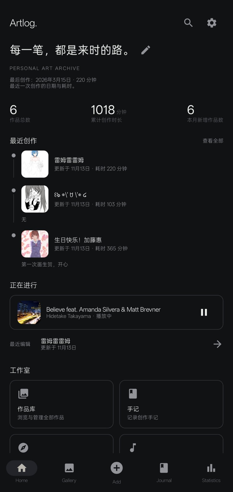
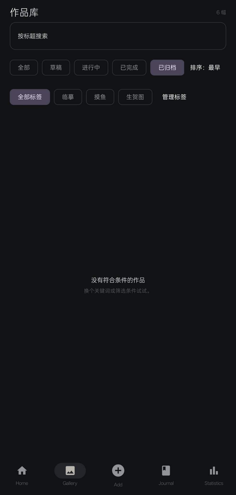
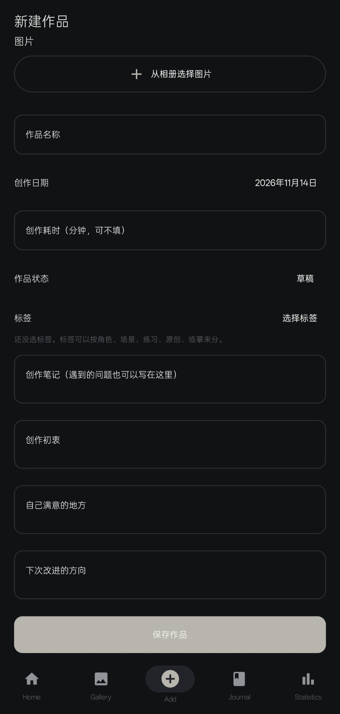
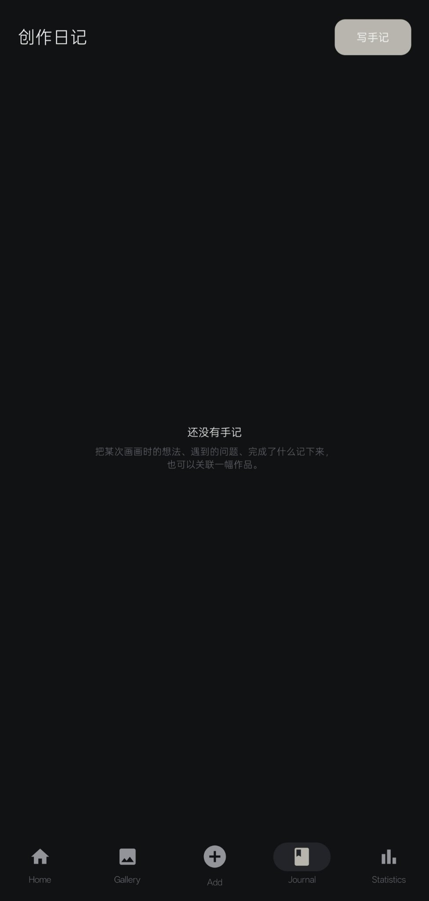
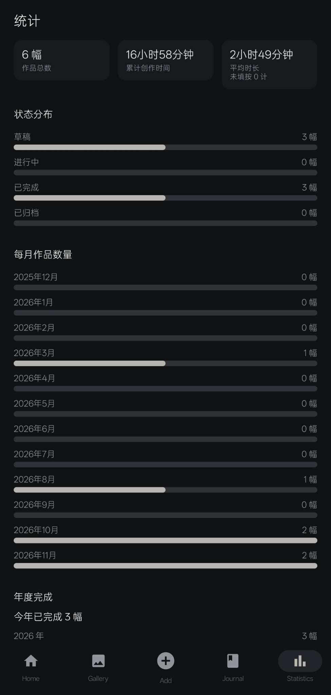

# Artlog

> A personal creative archive. Record your creations, preserve your journey.
>
> 个人创作记录与作品管理工具。**记录创作，留住时间。**

Artlog 不只是一个作品展示工具，更希望成为创作者保存灵感、作品、创作过程和个人记忆的地方。

## 功能

- **作品档案**：添加、查看、编辑、删除作品；记录作品名称、创作日期、创作耗时与创作总结；按标签整理；手记与创作统计（只计真实记录，不虚构数据）。
- **视觉灵感**：收录经核查的视觉网站导航（插画、摄影、建筑等），点击在系统浏览器打开原文；可收藏常用网站，也可添加自己的网站。
- **本地音乐**：本地音乐播放器，后台播放、通知栏与锁屏媒体控制；歌词显示与同步（支持内嵌歌词与 LRC 文件）；应用内与系统级悬浮歌词；列表循环与随机播放；专辑封面（读取音乐文件内嵌封面）。
- **个性化**：自定义背景图片与颜色、图片遮罩、文字大小与颜色、首页标题。
- **数据安全**：本地 ZIP 备份与恢复（数据库、原图与缩略图，逐文件 SHA-256 校验，恢复前先校验、失败可回滚）；图片完整性检查。
- **完全离线**：本地优先，无账号、无云同步、无统计上报。你的作品与数据只在你的设备上。

## 截图







## 下载与安装

1. 在本仓库的 [Releases](../../releases) 页下载最新版本的 `Artlog-v1.0.0.apk`。
2. 在手机上允许“安装未知来源应用”后安装即可。
3. 无需注册、无需联网。

### 系统要求

- Android 8.0（API 26）或更高版本。
- 安装后首次使用无需任何权限即可浏览已有内容；导入音乐、使用悬浮歌词等功能会在需要时再申请对应权限。

## 从源码构建

```bash
./gradlew assembleDebug
# 产物：app/build/outputs/apk/debug/app-debug.apk
```

环境要求：JDK 17、Android SDK（含 platform android-34、build-tools 34.0.0）。首次同步需联网下载 Gradle 8.5 与 AGP 8.5.2。

本仓库另含一套手动构建工具链（`manual-build/build.sh`，aapt2 + kotlinc + R8/D8 + zipalign + apksigner），用于 Gradle 无法运行的环境；普通机器请优先使用 Gradle。

## 许可证

Artlog 采用自定义非商业许可协议：**Artlog Non-Commercial License, Version 1.0**（见 [LICENSE](LICENSE)）。

- 永久免费使用。
- 可以学习、研究和修改源代码。
- 允许免费分享修改后的版本，但必须保留原作者署名和版权声明。
- 未经原作者明确书面许可，**不允许**将 Artlog 或其衍生版本作为收费产品出售或进行商业化运营。商业使用授权请联系原作者。
- **本许可不是 OSI 批准的标准开源许可证。**中文要点说明见 LICENSE 文件末尾（中文版仅供参考，不构成法律文本）；如有疑问，建议寻求专业法律意见。

## 作者介绍

**作者：飞舞网络卡死了**

联系方式（Bug 反馈）：3569694301@qq.com

### 开发初衷

绘画对我来说只是像打游戏一样下班后消磨时间的一种方式，我每天在绘画上的时间有限，有时候一幅画要分一个星期完成，未来的某一天也许我会放下画笔，但是总要留下些什么，我想着也许几年后的某一天，我打开它，发现还能找到几年前随手画下的一张草稿，以及当时写下的一句话，那一刻，记录的意义才真正显现出来。毕竟，创作不一定每次都要留下些什么伟大的东西。

### 创作理念

Artlog · 创作理念

创作不只是为了完成一件作品，记录也不只是为了保存一张图片。

我们相信，每一份创作都有它存在的意义。

它可以是一幅精心完成的插画，也可以是一张尚未成形的草稿；可以是一次成功的尝试，也可以是一次不尽如人意的练习。

作品记录着创作者的能力，而过程记录着创作者的成长。

我们希望 Artlog 不只是一个展示成果的地方，更是一个能够容纳灵感、尝试、失败、情绪与回忆的创作空间。

在这里，不必因为作品不够优秀而隐藏它，也不必因为进步缓慢而否定自己。

创作没有必要始终朝着某个既定的目标前进。

有时候，记录只是为了让未来的自己知道，曾经的自己在想些什么，又为什么开始创作。

我们记录作品，也记录创作本身。

因为每一份作品都来自某个具体的时刻，而每一个时刻，都值得被认真对待。

Artlog —— 记录创作，留住时间。

## 隐私

Artlog 本地优先、完全离线，不上传任何数据。详见 [PRIVACY.md](PRIVACY.md)。

## 贡献

欢迎提交 Issue 与 Pull Request，详见 [CONTRIBUTING.md](CONTRIBUTING.md)。作者保留对官方仓库代码合并、版本发布和商业授权的最终决定权。

## 致谢

Artlog 由作者本人构思与主导开发，开发过程中由 Muse（Meta 的个人 AI 助手）协助完成代码实现、测试与发布工作。
